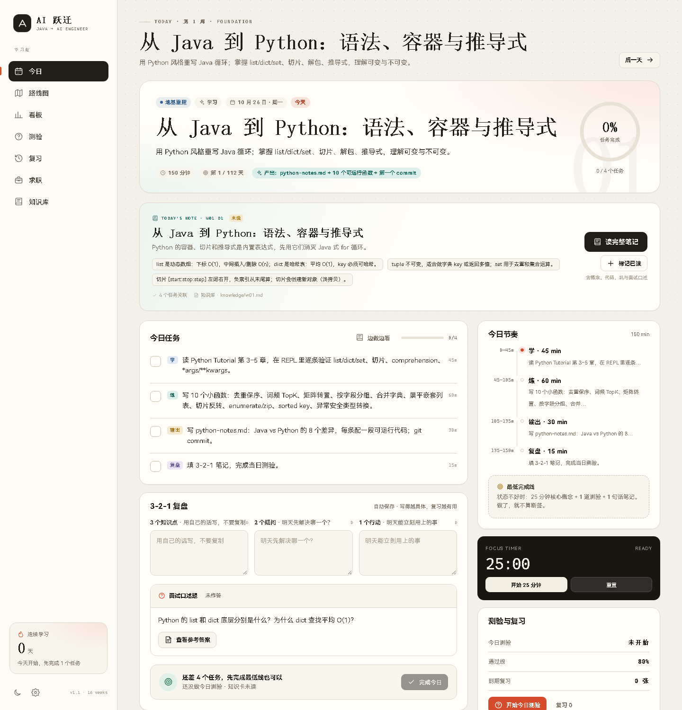

# AI 跃迁 · Java 后端 → AI 开发工程师学习助手



一个**零依赖、本地运行、数据只存在自己浏览器里**的 16 周学习驾驶舱。

它解决四件事：

1. **每天学什么**：112 天逐日任务、时长、产出物、口述题，不用每天重新做计划。
2. **有没有完成**：任务打勾、3-2-1 笔记、连续天数、阶段进度、16 周热力图。
3. **有没有掌握**：每天 2 道选择题 + 1 道口述题，周测 10 题；错题自动进复习队列。
4. **能不能拿到 offer**：三个项目规格、简历 bullet、项目故事卡、投递记录、面试速答卡。

配套的完整路线说明在 [PLAN.md](PLAN.md)。

---

## 快速开始

### 方式一：本地服务器（推荐）

需要 Node.js 18+。

双击 **`开始学习.cmd`**，或在本目录运行：

```bash
node server.mjs
```

浏览器会自动打开 `http://127.0.0.1:4173`。按 `Ctrl+C` 停止。

端口被占用时：

```bash
set PORT=4174 && node server.mjs
```

### 方式二：直接打开

直接双击 `index.html` 也能用。所有数据、脚本都在本地，不依赖 CDN。

> 建议用 Chrome / Edge。数据存在 `localStorage`，**清理浏览器缓存会丢失**，请定期在「设置 → 导出 JSON」备份。

---

## 第一次打开怎么用

1. 进入「今日」，如果还没到开始日期，会看到**开营准备清单**：装 Python、准备 API、固定学习时段、做基线自测。
2. 点「设置」确认开始日期、目标岗位、每天可用时间。默认从 **2026-10-26** 开始，共 112 天。
3. 每天按顺序：
   - 先读「今日知识卡」，点「标记已读」；
   - 看「今日任务」的 3–4 个任务，逐个完成并打勾；
   - 在知识卡内做「随堂小测」3 题，答对 2 题即可通过；
   - 写 3-2-1 复盘：3 个知识点、2 个疑问、1 个行动；
   - 做「今日测验」（2 选择 + 1 口述），低于 80% 重练错题；
   - 点「完成今日」打卡（任务完成 + 知识卡已读）。
4. 周日做「周测」，去「复习」清掉到期卡片。
5. 面试期用「求职」记录投递、写项目故事、刷面试速答卡。

**最低完成线**：25 分钟核心概念 + 1 道测验 + 1 句话笔记。状态差也算不断签。

---

## 功能地图

| 页面 | 你能做什么 |
|---|---|
| **今日** | 当日目标、知识卡与随堂小测、任务清单、产出物、节奏时间线、25 分钟专注计时、3-2-1 笔记、口述题自评、打卡 |
| **路线图** | 6 个阶段、16 周、112 天；每周目标、知识笔记入口、7 天卡片；可回看/补课任意一天 |
| **看板** | 连续天数、完成任务、累计投入、测验均分、16 周热力图、近 7 天投入、阶段/每周进度、薄弱主题 |
| **测验** | 每日测验、周测、随机 10 题、错题重练；选择题即时解析，口述题参考要点 + 自评 |
| **复习** | 口述卡/错题卡间隔复习（重来/模糊/记住/简单）；搜索 112 天笔记 |
| **求职** | 求职就绪度、10 项清单、投递记录、3 个项目故事卡、28 张面试速答卡 |
| **知识库** | 16 篇本地 Markdown、112 节知识卡、全文搜索、3 题随堂测、已读标记、A4 打印 |
| **设置** | 姓名/目标岗位/开始日期/每日时长/主题；导出、导入、清空数据 |

### 测验规则

- **随堂小测**：每节知识卡 3 题（2 道每日选择题 + 1 道判断题），答对 2 题通过；通过后自动标记知识卡“已读”。
- 每日：2 道单选 + 1 道口述；单选 1 分/题，口述自评 0 / 0.5 / 1 分；**80% 通过**。
- 周测：当周 10 道单选 + 2 道口述，覆盖整周主题。
- 选择题**连续答对 2 次**才标记为掌握；答错立即进入错题本和复习队列。
- 口述题自评「讲清楚了」→ 2 天后复习；「答得不全/没答上来」→ 当天进入队列。
- 「完成今日」要求：任务完成 + 知识卡已读；知识卡未读时会先打开笔记提醒。

---

## 16 周路线一览

| 周 | 主题 | 交付物 |
|---|---|---|
| W1 | Python 迁移 + AI 开发环境 | 流式 LLM CLI |
| W2 | FastAPI + 异步 + Docker | 流式对话 API |
| W3 | Transformer / token / 采样 | Token 与采样实验报告 |
| W4 | Prompt / 结构化输出 / 工具调用 | JD–简历匹配器 |
| W5 | Embedding / 切分 / 向量检索 | mini-rag + 20 条评测集 |
| W6 | 混合检索 / rerank / RAGAS | RAG 消融报告 |
| W7 | 项目一：企业知识库（上） | 上传→检索→引用主链路 |
| W8 | 项目一：生产化（下） | Docker + 监控 + 压测 + 视频 |
| W9 | Agent / ReAct / 工具 / 记忆 | 手写 mini-agent |
| W10 | LangGraph / 审批 / 多智能体 | 带审批工作流 |
| W11 | 项目二：Agent 平台 | 可追踪、可评测的 Agent 服务 |
| W12 | LoRA / QLoRA / 数据工程 | 微调 vs Prompt 对比 |
| W13 | vLLM / 量化 / Spring AI | Java + AI 模型网关 |
| W14 | 系统设计 / ML 八股 / 算法 | 10 道设计提纲 + 8 类模板 |
| W15 | 简历 / 故事 / 模拟面试 | 简历 v3 + 3 个项目故事 |
| W16 | 投递 / 面试迭代 / Offer | 60+ 投递 + Offer 决策表 |

**重要预期**：16 周是“面试就绪、开始投递”的时间，不是“保证 offer”。按计划执行，通常在投递后 4–8 周拿 offer；春节（2027-02-06）前后节奏会变慢，计划已留弹性。

---

## 知识库（本地 Markdown）

资料不再是一堆外链，而是 16 篇本地周笔记：

- `knowledge/w01.md` ~ `knowledge/w16.md`：每周 7 节，共 112 节。
- 每节包含：一句话、核心知识、速查/代码、常见坑、面试口述。
- 每节自动关联当天的 3–4 个任务；今日页会显示知识卡和“读完整笔记”入口。
- 每节有 **3 题随堂小测**（2 道每日选择题 + 1 道判断题），答对 2 题即通过，通过后自动标记已读。
- 知识库页面支持全文搜索、按周浏览、已读进度；今日完成度要求“任务完成 + 知识卡已读”。
- 支持导出 **A4 复习册**：网页打印版 + 预生成 PDF。

### 修改知识笔记

直接编辑 `knowledge/wNN.md`，然后重新生成前端数据：

```bash
node scripts/build-knowledge.mjs
```

生成结果写入 `data/knowledge.js`（不要手改）。Markdown 约定：

```markdown
# W01 · 标题
## Day 1 · 小节标题
**一句话**：...
**核心知识**
- ...
```

### A4 复习册

- 网页打印版：`print.html`，浏览器打印时选择 **A4 / 纵向 / 默认边距 / 背景图形**。
- 预生成 PDF：`16周知识复习册.pdf`（约 34 页）。
- 修改知识库后，重新生成 PDF：

```bash
node scripts/build-knowledge.mjs
# Windows 示例，Chrome 路径按本机调整
"C:\Program Files (x86)\Google\Chrome\Application\chrome.exe" ^
  --headless=new --disable-gpu --no-pdf-header-footer ^
  --print-to-pdf="16周知识复习册.pdf" ^
  "http://127.0.0.1:4173/print.html"
```

---

## 数据与备份

- 存储键：`ai-jump-coach-v1`（浏览器 localStorage）。
- 「设置 → 导出 JSON」会导出完整状态：任务、笔记、测验、复习卡、投递、故事卡。
- 换电脑：旧电脑导出 → 新电脑「导入 JSON」。
- 清空进度不可撤销，会二次确认。

### 想改计划 / 题目？

- `data/meta.js`：阶段、项目规格、Java 迁移地图、术语表、求职清单。
- `data/curriculum-1.js` ~ `curriculum-4.js`：16 周每日任务、口述题。
- `data/quiz-1.js` ~ `quiz-4.js`：192 道每日选择题（每周 12 道）。
- `data/quiz-quick.js`：112 道随堂判断题（每节知识卡 1 道，和 2 道每日选择题组成 3 题小测）。
- `data/library.js`：28 张面试速答卡。
- `knowledge/*.md`：知识库正文，改完运行 `node scripts/build-knowledge.mjs`。

改完刷新页面即可。每天题目通过 `week` + `day` 关联，新增题保持 `id` 唯一。

---

## 文件结构

```
ai-career-coach/
├─ index.html              # 单页入口
├─ print.html              # A4 复习册打印版
├─ 16周知识复习册.pdf       # 预生成 PDF
├─ server.mjs              # 零依赖静态服务器
├─ 开始学习.cmd            # Windows 一键启动
├─ PLAN.md                 # 16 周完整作战计划
├─ README.md
├─ knowledge/              # 16 篇周笔记（Markdown 源文件）
├─ scripts/
│  └─ build-knowledge.mjs  # 生成 data/knowledge.js
├─ assets/
│  ├─ styles.css           # 主界面视觉与响应式布局
│  ├─ app.js               # 全部交互逻辑（原生 JS）
│  ├─ print.css            # A4 打印样式
│  └─ print.js             # 复习册渲染
└─ data/
   ├─ meta.js              # 元数据 / 项目 / 术语
   ├─ curriculum-1..4.js   # 112 天课程
   ├─ quiz-1..4.js         # 192 道每日选择题
   ├─ quiz-quick.js        # 112 道随堂判断题
   ├─ knowledge.js         # 自动生成，勿手改
   └─ library.js           # 面试卡
```

---

## 设计说明

- 运行时无框架、无 CDN，断网可用；知识库由脚本预生成，打开即用。
- 浅色“纸张 + 朱砂 + 墨绿”与深色“夜间驾驶舱”两套主题。
- 桌面侧边栏 / 移动端底部导航，适配手机刷任务。
- 周测按周做确定性抽题，避免每次题目完全一样；同一天重复测会看到同一组题。
- 复习采用简化 SM-2：根据自评调整间隔和 ease，不追求算法复杂，追求每天愿意用。

---

## 最后

工具只是放大器。真正让你拿到 offer 的，是每天那一个 commit、那一次口述、那一道错题。

> 先完成，再完美。先投递，再紧张。
